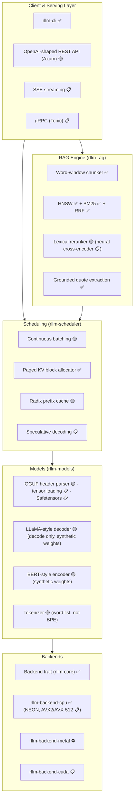

# `rllm` Architecture

This document describes the **target architecture** of `rllm` and marks, for each subsystem, how much of it exists today. For a component-by-component status table and the list of known bugs, see the [README](../README.md#-project-status).

Legend: ✅ implemented · 🟡 partial / prototype · ⛔ stub · 📋 planned (no code yet)

---

## 1. Layered Design



---

## 2. Target Hardware Tiers

These are design goals. Today only the CPU backend executes; there is no Metal or CUDA execution path.

| Tier | Target platforms | Intended techniques | Today |
| :--- | :--- | :--- | :--- |
| Edge / smartphone | iOS, Android (ARM64) | Q4/Q8 block quantization, mmap weights, NEON, Metal | NEON F32 dot/GEMV and scalar Q4_0/Q8_0 GEMV on CPU |
| Workstation / unified memory | Apple Silicon | Metal compute pipelines, zero-copy unified memory | MSL source only; no dispatch |
| GPU cluster | NVIDIA data-center GPUs | CUDA, FlashAttention, tensor parallelism | Not started |

---

## 3. Crates

```text
crates/
├── rllm-core/          # Tensor, Shape, DType, Device, Storage, Backend trait, errors
├── rllm-backend-cpu/   # CPU kernels
├── rllm-backend-metal/ # Metal backend stub + MSL shaders
├── rllm-models/        # LlamaModel, BertEmbeddingModel, GgufFile, Tokenizer, configs
├── rllm-scheduler/     # BlockAllocator, PrefixCache, ContinuousBatchScheduler, Sampler, Sequence
├── rllm-rag/           # TextChunker, HnswIndex, Bm25Index, HybridIndex, reranker, grounding, RagEngine
├── rllm-server/        # Axum router and handlers
└── rllm-cli/           # serve / bench / rag-demo
```

A `rllm-backend-cuda` crate is planned but does not exist.

---

## 4. Subsystems

### 4.1 Tensor & Backend Abstraction (`rllm-core`) — ✅

- `Tensor` holds a shape, strides, dtype, device, byte offset and a `Storage` (`Cpu`, `Metal`, `Cuda`). Only `Cpu` storage holds data; `Metal`/`Cuda` variants are placeholders.
- `reshape` and `transpose` are zero-copy views. **CPU kernels currently read storage as contiguous and ignore strides** — see Known Issues.
- `Backend` is an object-safe trait with: `matmul`, `rms_norm`, `rope`, `swiglu`, `softmax`, `embedding`, `paged_attention`, `gemv_quantized`.
- `DType` declares `F32, F16, BF16, I32, I8, Q4_0, Q4_K, Q8_0`. Only `F32` compute and `Q4_0`/`Q8_0` GEMV are implemented.

### 4.2 CPU Backend (`rllm-backend-cpu`) — ✅ / 🟡

- F32 dot product with ARM NEON FMA on `aarch64`; 4-way unrolled scalar elsewhere.
- GEMV parallelised over output rows with Rayon. GEMM is a naive row-parallel loop (🟡; tiling/packing planned).
- Q4_0 (32 elements / 18 bytes) and Q8_0 (32 / 34 bytes) GEMV operate directly on quantized blocks without dequantizing the full matrix. Inner loops are scalar.
- PagedAttention decode: per-head logits over a block table, softmax, weighted V accumulation; GQA supported.

### 4.3 Models (`rllm-models`) — 🟡

- `LlamaModel::forward_decode` runs one token per sequence through embedding → N × (RMSNorm, QKV, RoPE, KV write, PagedAttention, O-proj, RMSNorm, SwiGLU MLP) → final norm → LM head. There is **no prefill** (multi-token) forward.
- `BertEmbeddingModel::embed` runs a simplified encoder with mean pooling and L2 normalisation.
- Both models are constructed only via `new_random` (constant / patterned weights).
- `GgufFile::read_from_bytes` parses magic, version, metadata KV pairs and tensor descriptors, and computes the aligned data offset. It does not read tensor payloads or map them onto model layers.
- `Tokenizer` is a fixed English/technical word list with ASCII fallback; it is a placeholder until a real BPE tokenizer is integrated.

### 4.4 Scheduling (`rllm-scheduler`) — 🟡

- **Paged KV cache:** per-layer K/V tensors of shape `[total_blocks, num_kv_heads, block_size, head_dim]`; `BlockAllocator` hands out block IDs from a free list with reference counts.
- **Radix prefix cache:** a token trie that records a physical block ID at every `block_size` boundary; `match_prefix` returns the longest fully cached block-aligned prefix. Target design: the cache holds its own reference to cached blocks, evicts LRU, and copy-on-write protects shared partial blocks. **Today it holds no reference** (Known Issue 3).
- **Continuous batching:** `step()` admits waiting sequences while blocks are available, ensures capacity for the next token, runs one batched decode, samples, and retires finished sequences. Target design: a dedicated engine loop that performs prefill for newly admitted sequences, supports preemption, and serves requests through per-sequence channels.
- **Sampler:** greedy, temperature, top-k, top-p, repetition penalty.

### 4.5 RAG (`rllm-rag`)

- **Chunking** ✅ — sliding window over whitespace-delimited words (default 128 words, 32 overlap).
- **HNSW** ✅ — in-memory multi-layer graph, cosine distance (NEON dot on `aarch64`). Persistence and SQ8 vector quantization are planned.
- **BM25** ✅ — Okapi BM25 (`k1 = 1.2`, `b = 0.75`) over a lowercase alphanumeric tokenisation.
- **Hybrid fusion** ✅ — Reciprocal Rank Fusion (`k = 60`) of dense and BM25 rankings.
- **Reranking** 🟡 — `CrossEncoderReranker` is currently a lexical scorer (content-keyword coverage, term density, exact-phrase bonus). A neural cross-encoder is planned.
- **Grounding & relevance** ✅ — sentence-level quote extraction keyed on non-stop-word query terms; queries whose best score is below `min_relevance_threshold` (default 0.25) are returned with `is_relevant: false` and a `warning`, without invoking generation.
- **Answer generation** 🟡 — today the answer is assembled from extracted quotes by a template, and model output is appended only if a heuristic deems it coherent. Target design: the LLM generates the answer from the grounded prompt, and citations are verified against the output.
- **Prefix-aware context ordering** 📋 — ordering retrieved chunks to maximise radix-cache hits is a design goal and is not implemented.

### 4.6 Serving (`rllm-server`) — 🟡

- Service modes: `all`, `inference`, `rag`. In `rag` mode with `INFERENCE_URL` set, retrieval runs locally and generation is delegated to the inference container's `/v1/chat/completions`.
- Handlers currently drive `scheduler.step()` inline until the scheduler is idle; this is a placeholder for a dedicated engine task.
- Chat and embeddings endpoints do not yet tokenize input text (placeholder token IDs).
- SSE streaming, gRPC, authentication, request limits and metrics are planned.

---

## 5. Known Issues

See the [README](../README.md#-known-issues). In short: stride-ignoring matmul on transposed weights, no prefill, per-batch RoPE applied repeatedly, prefix-cache block ownership, unbounded input lengths, and unaligned `f32` views over byte storage.
