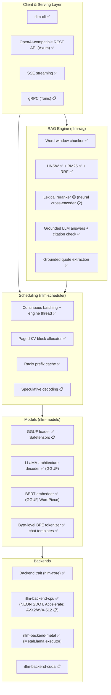

# `rllm` Architecture

This document describes the **target architecture** of `rllm` and marks, for each subsystem, how much of it exists today. For a component-by-component status table and the list of known bugs, see the [README](../README.md#-project-status).

Legend: ✅ implemented · 🟡 partial / prototype · ⛔ stub · 📋 planned (no code yet)

---

## 1. Layered Design



---

## 2. Target Hardware Tiers

These are design goals. Today the CPU backend and a Metal executor (Apple GPUs) execute; there is no CUDA path.

| Tier | Target platforms | Intended techniques | Today |
| :--- | :--- | :--- | :--- |
| Edge / smartphone | iOS, Android (ARM64) | Q4/Q8 block quantization, mmap weights, NEON, Metal | NEON F32 dot/GEMV and scalar Q4_0/Q8_0 GEMV on CPU |
| Workstation / unified memory | Apple Silicon | Metal compute pipelines, unified memory | `MetalLlama`: whole-model command buffers, shared-memory weights, GPU KV cache |
| GPU cluster | NVIDIA data-center GPUs | CUDA, FlashAttention, tensor parallelism | Not started |

---

## 3. Crates

```text
crates/
├── rllm-core/          # Tensor, Shape, DType, Device, Storage, Backend trait, errors
├── rllm-backend-cpu/   # CPU kernels
├── rllm-backend-metal/ # MetalLlama: Apple GPU executor + MSL kernels
├── rllm-models/        # LlamaModel, BertEmbeddingModel, GgufFile, Tokenizer, configs
├── rllm-scheduler/     # BlockAllocator, PrefixCache, ContinuousBatchScheduler, Sampler, Sequence
├── rllm-rag/           # TextChunker, HnswIndex, Bm25Index, HybridIndex, reranker, grounding, RagEngine
├── rllm-server/        # Axum router and handlers
└── rllm-cli/           # serve / bench / rag-demo
```

A `rllm-backend-cuda` crate is planned but does not exist.

---

## 4. Subsystems

### 4.1 Tensor & Backend Abstraction (`rllm-core`) — ✅

- `Tensor` holds a shape, strides, dtype, device, byte offset and a `Storage` (`Cpu`, `Metal`, `Cuda`). Only `Cpu` storage holds data; GPU execution does not go through per-operation tensors but through whole-model executors (see 4.2b).
- `reshape` and `transpose` are zero-copy views. `as_f32_slice` rejects non-contiguous views; `contiguous()` materialises them. CPU `matmul` recognises a transposed contiguous weight (`W.transpose(0, 1)`) and computes `A·Wᵀ` with row dot products without copying.
- `CpuStorage` is 64-byte aligned.
- `Backend` is an object-safe trait with: `matmul`, `rms_norm`, `rope`, `swiglu`, `softmax`, `embedding`, `paged_attention`, `gemv_quantized`.
- `DType` declares `F32, F16, BF16, I32, I8, Q4_0, Q4_K, Q8_0, Q5_0, Q6_K` and the CPU-internal `Q4_0x4` (Q4_0 repacked into interleaved 4-row groups). Compute is F32; linear layers run integer kernels on Q8_0, Q4_0, Q5_0, Q4_K, Q6_K and Q4_0x4 weights. `Backend::pack_weight` lets a backend convert weights into its preferred layout at load (the CPU backend repacks Q4_0 and expands Q5_0 losslessly to Q8_0).

### 4.2 CPU Backend (`rllm-backend-cpu`) — ✅

- **Quantized linear layers** (`ops/qdot.rs`): for decode and small batches, activations are quantized once per call to Q8 blocks (f16-rounded scale, like llama.cpp's `quantize_row_q8_0`) and multiplied with Q8_0 / Q4_0 weight blocks in integer arithmetic. On aarch64 with the `dotprod` extension (runtime-detected) the inner products use `SDOT`, emitted via inline assembly because `vdotq_s32` is only stable from Rust 1.98; elsewhere a scalar loop is used.
- **Batched products** (≥ 32 rows, i.e. prefill): quantized weights are dequantized and multiplied with F32 activations by `ops/blas.rs::sgemm_nt`, which calls Accelerate's `cblas_sgemm` on macOS and a portable row-parallel kernel elsewhere. This matches llama.cpp's CPU behaviour.
- **Parallelism:** the forward pass runs inside the Rayon pool (`rayon::scope`), so inner kernels use work-stealing. Element-wise kernels below 16 Ki elements run on one thread; matrix-vector products split into ~128 KiB weight slabs (`RLLM_TASK_BYTES`). `threads::init_thread_pool` defaults to the number of performance cores on Apple Silicon. Decode-sized work (matrix-vector products, integer GEMMs and attention for batches under 32 rows) runs on `pool`, a fork/join pool of the same size whose workers spin for 200 µs after each job (`RLLM_SPIN_US`) before parking, so the ~100–200 small steps of a decoded token do not each pay a thread wake-up; prefill stays on Rayon so the two pools never compete for cores.
- **PagedAttention:** one work item per (row, KV head) computes every query head of the GQA group in one pass over that head's cached keys and values, walking the block table block by block. One row per prompt token gives causal prefill; one row per sequence gives batched decode.
- F32 dot products use NEON FMA on aarch64. RMSNorm, LayerNorm, RoPE, SwiGLU, GELU and softmax are scalar / auto-vectorised.

### 4.2b Metal executor (`rllm-backend-metal`) — ✅

GPU execution is a whole-model executor rather than a per-operation `Backend`: dispatching hundreds of small operations per token with a host round-trip each would be slower than the CPU. `MetalLlama::from_cpu_model` copies a loaded model's weights once into shared-memory Metal buffers and implements `LanguageModel`, so the scheduler, engine, server and RAG use it unchanged (`--device metal`).

- **One command buffer per forward pass.** Embedding lookup, every layer (RMSNorm, Q/K/V projections, RoPE, KV-cache write, attention, output projection, residuals, SwiGLU MLP) and the final norm + LM head on the requested rows are encoded into a single serial compute encoder; the host waits once and reads the logits from shared memory.
- **Linear layers:** F32 / Q8_0 / Q4_0 weights in GGUF block layout. Up to 8 rows use a matrix-vector kernel (one simdgroup per 4 output rows); larger batches use a 32×32-tile GEMM with weights dequantized into threadgroup memory and 8×8 `simdgroup_float8x8` multiply-accumulates. Activations stay F32 (as in llama.cpp's Metal backend).
- **Attention:** consecutive prompt rows of one sequence are grouped into tiles of up to 8 and processed FlashAttention-style (one simdgroup per head and tile, K/V read once per tile as 8×8 fragments from the paged cache, per-row online softmax with causal masking). Single rows (decode) use a kernel where four simdgroups split the keys in 32-position tiles and merge their partial softmax states.
- **KV cache:** per-layer private GPU buffers in the same paged layout as the CPU, F16 (default) or F32 following the CPU model's `kv_dtype`, zero-initialised; block size must be a multiple of 8. Decode attention splits each row's context into 256-key chunks (one threadgroup each) and combines the partial softmax results in a reduction kernel, so a single sequence at long context still fills the GPU.
- **Constraints:** head_dim a multiple of 32 and at most 128; hidden and intermediate sizes multiples of 32. Shaders are compiled at load with `newLibraryWithSource`.

### 4.3 Models (`rllm-models`) — ✅

- `LlamaModel::forward` takes a flattened batch of rows, each with its own token, absolute position and block table: embedding → N × (RMSNorm, QKV, per-row RoPE, KV write for every row, causal PagedAttention, O-proj, RMSNorm, SwiGLU MLP) → final norm → LM head for selected rows only. All prompt tokens of a sequence = causal prefill; one token per sequence = batched decode; both can be mixed. `forward_decode` is a convenience wrapper.
- Numerical tests compare it against a naive dense reference implementation.
- **GGUF loading.** `MappedGguf` memory-maps the file and parses typed metadata and tensor descriptors. `LlamaConfig::from_gguf` reads `llama.*` hyper-parameters; `LlamaModel::from_gguf` maps `token_embd`, `blk.N.{attn_q,attn_k,attn_v,attn_output,attn_norm,ffn_gate,ffn_up,ffn_down,ffn_norm}`, `output_norm` and `output` (falling back to tied embeddings) onto layers, and applies `rope_freqs` factors when present. Linear weights in Q8_0 / Q4_0 / Q5_0 / Q4_K / Q6_K stay quantized and go through `Backend::linear` (then `LlamaModel::pack_for_backend` applies the backend's packing); Q4_1, Q5_1 and Q5_K are converted to Q8_0, and F16 / BF16 to F32, at load. `GgufBundle::load` returns the model, tokenizer and chat template from one file.
- **Tokenizer.** `BpeTokenizer` implements llama.cpp-compatible byte-level BPE from `tokenizer.ggml.{tokens,token_type,merges,pre}`: special-token splitting, per-model pre-tokenizer regexes applied in sequence, rank-ordered merges, and streaming UTF-8 decode (`StreamDecoder`). Stop tokens come from EOS/EOT metadata plus known end-of-turn markers.
- **Chat templates.** `ChatTemplate` renders the model's Jinja `tokenizer.chat_template` with minijinja (Python-compatible methods, `raise_exception`, `bos_token`, `eos_token`), falling back to ChatML.
- **Verification.** Besides the dense reference test, `tests/real_model.rs` compares tokenization and greedy generation with llama.cpp fixtures for SmolLM2-135M in five weight formats.
- **Embeddings.** `TextEmbedder::from_gguf` loads a `bert`-architecture model (token, position and token-type embeddings; post-norm encoder layers with biases; GELU FFN; mean or `[CLS]` pooling from `bert.pooling_type`; L2 normalisation) and its `WordPieceTokenizer` (BERT basic tokenization + greedy longest-match, `▁`-prefixed word-initial pieces as stored in GGUF). Inputs beyond `bert.context_length` are truncated, keeping `[SEP]`. `calibrated_dense_threshold()` gives the relevance cutoff for known models.
- The legacy word-list `Tokenizer` is only used by synthetic test models.

### 4.4 Scheduling (`rllm-scheduler`) — 🟡

- **Paged KV cache:** per-layer K/V tensors of shape `[total_blocks, num_kv_heads, block_size, head_dim]`, F16 by default (`LoadOptions::kv_dtype`, `--kv-dtype f16|f32`; half the memory and bandwidth, as in llama.cpp; synthetic test models use F32), widened to F32 in registers by the CPU attention kernels; `BlockAllocator` hands out block IDs from a free list with reference counts.
- **Radix prefix cache:** a radix tree with one node per full KV block, keyed by the block's tokens; `match_prefix` returns the longest cached block-aligned prefix with one hash probe per block. Full blocks are recorded as soon as a forward pass completes them (they are never written again), so running sequences share their prefix with later requests; finished and preempted sequences leave theirs behind. The cache holds one allocator reference per cached block, so cached blocks are never on the free list; when the pool is exhausted, least-recently-used leaf blocks not used by any sequence are evicted. Matching happens at admission and always leaves at least one token to compute. Only full blocks are shared (no copy-on-write of partial blocks yet).
- **Model interface:** the scheduler drives any `LanguageModel` (`config`, `init_kv_cache`, `forward_cached`); the model owns its paged KV cache. `LlamaModel<CpuBackend>` and `MetalLlama` implement it.
- **Continuous batching:** `step()` admits waiting sequences while blocks are available, ensures capacity for the next token, runs one batched decode, samples, and retires finished sequences. Each step prefills newly admitted sequences (subject to `max_prefill_tokens`) together with decoding running ones; under KV pressure the newest sequence is preempted and later recomputed; a sequence larger than the whole pool finishes with `Length`.
- **Engine thread:** `EngineHandle::start` spawns one thread that steps the scheduler while any sequence is waiting or running and sleeps on a condition variable otherwise. `EngineHandle::submit` validates the request, rejects it with `SubmitError::Overloaded` if `max_waiting` sequences are already queued, and returns a `GenerationStream` of `SequenceEvent`s (`Token`, then exactly one `Finished(reason)` or `Error`). Tokens are delivered through each sequence's own channel, so they reach the right owner whichever thread steps.
- **Cancellation:** dropping a `GenerationStream` closes its channel. At the next step the scheduler drops cancelled waiting sequences and retires cancelled running ones as `Finished(Abort)`, freeing their KV blocks (computed full blocks go to the prefix cache).
- **Failure handling:** if a step returns an error, every in-flight sequence receives an `Error` event and its blocks are freed (`fail_all`).
- **Metrics:** `SchedulerMetrics` counts submissions, finishes by reason, prefill / cached / generated tokens, forward passes and forward time.
- **Sampler:** greedy, temperature, top-k, top-p, repetition penalty.

### 4.5 RAG (`rllm-rag`)

- **Chunking** ✅ — sliding window over whitespace-delimited words (default 128 words, 32 overlap).
- **HNSW** ✅ — in-memory multi-layer graph, cosine distance (NEON dot on `aarch64`). Persistence and SQ8 vector quantization are planned.
- **BM25** ✅ — Okapi BM25 (`k1 = 1.2`, `b = 0.75`) over a lowercase alphanumeric tokenisation.
- **Hybrid fusion** ✅ — Reciprocal Rank Fusion (`k = 60`) of dense and BM25 rankings.
- **Reranking** 🟡 — `CrossEncoderReranker` is a lexical scorer (content-keyword coverage, term density, exact-phrase bonus). A neural cross-encoder is planned.
- **Relevance gating** ✅ — `RagEngine::retrieve` takes the RRF-ordered candidates and keeps a passage if its lexical score ≥ `min_relevance_threshold` (default 0.25, with at least one query keyword in the grounded quote) **or** its embedding cosine similarity ≥ `min_dense_similarity`. Similarity scales differ by model, so the dense threshold comes from `TextEmbedder::calibrated_dense_threshold` (bge-small-en-v1.5: 0.6 — related ≥ 0.67, unrelated ≤ 0.55; all-MiniLM-L6-v2: 0.3 — related ≥ 0.42, unrelated ≤ 0.14; measured on a small paraphrase/off-topic set) or a configured value. If nothing passes, the query is refused with `is_relevant: false` and no generation.
- **Answer generation** ✅ — `grounded_messages` builds a system prompt with numbered source passages and an instruction to cite them as `[n]`, rendered with the LLM's chat template. Sources are dropped from the end if the prompt would not leave room for `max_tokens`. With no `LlmGenerator` (and no remote inference service), the answer is extractive: each source's grounded quote with its number.
- **Citation verification** ✅ — `verify_citations` sets `cited_in_answer` for every valid `[n]` and returns a warning if the answer cites no source or a non-existent one. It does not check that the cited text supports the claim.
- **Prefix-aware context ordering** 📋 — ordering retrieved chunks to maximise radix-cache hits is a design goal and is not implemented.

### 4.6 Serving (`rllm-server`) — ✅

- **Modes:** `all`, `inference`, `rag`. In `rag` mode with `INFERENCE_URL` set, retrieval runs locally and generation is delegated to the inference service's `/v1/chat/completions`.
- **Chat completions** go through the engine: the conversation is rendered with the model's chat template, submitted with the model's stop tokens, and either collected (`finish_reason`, usage) or streamed as SSE `chat.completion.chunk` events (role chunk, content chunks decoded with `StreamDecoder` so multi-byte characters never split, a final chunk with `finish_reason`, an optional usage chunk, then `[DONE]`). When an HTTP client disconnects, axum drops the response stream and with it the `GenerationStream`, cancelling the sequence.
- **Errors** use OpenAI's `{"error": {"message", "type"}}` format: 400 for invalid parameters or prompts (empty messages, `max_tokens` outside 1..=limit, temperature outside 0..=2, prompts longer than the context window), 429 with `Retry-After: 1` when the queue is full, 503 while shutting down.
- **Limits** (`ServerLimits`): `max_tokens` cap, default `max_tokens`, request body size (2 MiB), number of embedding inputs per request.
- **Metrics:** `GET /metrics` in Prometheus text format: HTTP requests by route and status, request duration (until headers; streamed bodies are not included), in-flight requests, 429 rejections, time to first token, running/waiting sequences, KV blocks (total/free/prefix-cached), finishes by reason, preemptions, prompt tokens computed vs served from cache, generated tokens, forward passes and forward time.
- **Shutdown:** on SIGTERM / Ctrl-C the server stops accepting connections, waits for in-flight requests (including streams) to finish, then stops the engine.
- `/v1/embeddings` uses the server's `TextEmbedder` (`--embedding-model`); RAG answers are generated by the local GGUF model (through the engine), by the remote inference service in split deployments, or extractively.
- Not implemented: authentication, per-client rate limiting, TLS, gRPC, the legacy `/v1/completions` endpoint, `n > 1`, `stop` strings, logprobs.

---

## 5. Known Issues

See the [README](../README.md#-known-issues--limitations). P0–P2 are complete; the main remaining gaps are performance (several times slower than llama.cpp, CPU only) and architecture coverage (LLaMA and BERT only).
