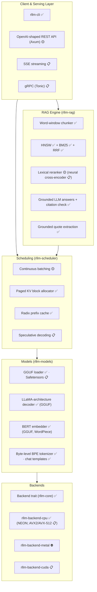

# `rllm` Architecture

This document describes the **target architecture** of `rllm` and marks, for each subsystem, how much of it exists today. For a component-by-component status table and the list of known bugs, see the [README](../README.md#-project-status).

Legend: ✅ implemented · 🟡 partial / prototype · ⛔ stub · 📋 planned (no code yet)

---

## 1. Layered Design



---

## 2. Target Hardware Tiers

These are design goals. Today only the CPU backend executes; there is no Metal or CUDA execution path.

| Tier | Target platforms | Intended techniques | Today |
| :--- | :--- | :--- | :--- |
| Edge / smartphone | iOS, Android (ARM64) | Q4/Q8 block quantization, mmap weights, NEON, Metal | NEON F32 dot/GEMV and scalar Q4_0/Q8_0 GEMV on CPU |
| Workstation / unified memory | Apple Silicon | Metal compute pipelines, zero-copy unified memory | MSL source only; no dispatch |
| GPU cluster | NVIDIA data-center GPUs | CUDA, FlashAttention, tensor parallelism | Not started |

---

## 3. Crates

```text
crates/
├── rllm-core/          # Tensor, Shape, DType, Device, Storage, Backend trait, errors
├── rllm-backend-cpu/   # CPU kernels
├── rllm-backend-metal/ # Metal backend stub + MSL shaders
├── rllm-models/        # LlamaModel, BertEmbeddingModel, GgufFile, Tokenizer, configs
├── rllm-scheduler/     # BlockAllocator, PrefixCache, ContinuousBatchScheduler, Sampler, Sequence
├── rllm-rag/           # TextChunker, HnswIndex, Bm25Index, HybridIndex, reranker, grounding, RagEngine
├── rllm-server/        # Axum router and handlers
└── rllm-cli/           # serve / bench / rag-demo
```

A `rllm-backend-cuda` crate is planned but does not exist.

---

## 4. Subsystems

### 4.1 Tensor & Backend Abstraction (`rllm-core`) — ✅

- `Tensor` holds a shape, strides, dtype, device, byte offset and a `Storage` (`Cpu`, `Metal`, `Cuda`). Only `Cpu` storage holds data; `Metal`/`Cuda` variants are placeholders.
- `reshape` and `transpose` are zero-copy views. `as_f32_slice` rejects non-contiguous views; `contiguous()` materialises them. CPU `matmul` recognises a transposed contiguous weight (`W.transpose(0, 1)`) and computes `A·Wᵀ` with row dot products without copying.
- `CpuStorage` is 64-byte aligned.
- `Backend` is an object-safe trait with: `matmul`, `rms_norm`, `rope`, `swiglu`, `softmax`, `embedding`, `paged_attention`, `gemv_quantized`.
- `DType` declares `F32, F16, BF16, I32, I8, Q4_0, Q4_K, Q8_0`. Only `F32` compute and `Q4_0`/`Q8_0` GEMV are implemented.

### 4.2 CPU Backend (`rllm-backend-cpu`) — ✅ / 🟡

- F32 dot product with ARM NEON FMA on `aarch64`; 4-way unrolled scalar elsewhere.
- GEMV parallelised over output rows with Rayon. GEMM is a naive row-parallel loop (🟡; tiling/packing planned).
- Q4_0 (32 elements / 18 bytes) and Q8_0 (32 / 34 bytes) GEMV operate directly on quantized blocks without dequantizing the full matrix. Inner loops are scalar.
- PagedAttention decode: per-head logits over a block table, softmax, weighted V accumulation; GQA supported.

### 4.3 Models (`rllm-models`) — ✅

- `LlamaModel::forward` takes a flattened batch of rows, each with its own token, absolute position and block table: embedding → N × (RMSNorm, QKV, per-row RoPE, KV write for every row, causal PagedAttention, O-proj, RMSNorm, SwiGLU MLP) → final norm → LM head for selected rows only. All prompt tokens of a sequence = causal prefill; one token per sequence = batched decode; both can be mixed. `forward_decode` is a convenience wrapper.
- Numerical tests compare it against a naive dense reference implementation.
- **GGUF loading.** `MappedGguf` memory-maps the file and parses typed metadata and tensor descriptors. `LlamaConfig::from_gguf` reads `llama.*` hyper-parameters; `LlamaModel::from_gguf` maps `token_embd`, `blk.N.{attn_q,attn_k,attn_v,attn_output,attn_norm,ffn_gate,ffn_up,ffn_down,ffn_norm}`, `output_norm` and `output` (falling back to tied embeddings) onto layers, and applies `rope_freqs` factors when present. Linear weights in Q8_0 / Q4_0 stay quantized and go through `Backend::linear`; F16, BF16, Q4_1, Q5_0, Q5_1, Q4_K, Q5_K and Q6_K are dequantized to F32 at load. `GgufBundle::load` returns the model, tokenizer and chat template from one file.
- **Tokenizer.** `BpeTokenizer` implements llama.cpp-compatible byte-level BPE from `tokenizer.ggml.{tokens,token_type,merges,pre}`: special-token splitting, per-model pre-tokenizer regexes applied in sequence, rank-ordered merges, and streaming UTF-8 decode (`StreamDecoder`). Stop tokens come from EOS/EOT metadata plus known end-of-turn markers.
- **Chat templates.** `ChatTemplate` renders the model's Jinja `tokenizer.chat_template` with minijinja (Python-compatible methods, `raise_exception`, `bos_token`, `eos_token`), falling back to ChatML.
- **Verification.** Besides the dense reference test, `tests/real_model.rs` compares tokenization and greedy generation with llama.cpp fixtures for SmolLM2-135M in five weight formats.
- **Embeddings.** `TextEmbedder::from_gguf` loads a `bert`-architecture model (token, position and token-type embeddings; post-norm encoder layers with biases; GELU FFN; mean or `[CLS]` pooling from `bert.pooling_type`; L2 normalisation) and its `WordPieceTokenizer` (BERT basic tokenization + greedy longest-match, `▁`-prefixed word-initial pieces as stored in GGUF). Inputs beyond `bert.context_length` are truncated, keeping `[SEP]`. `calibrated_dense_threshold()` gives the relevance cutoff for known models.
- The legacy word-list `Tokenizer` is only used by synthetic test models.

### 4.4 Scheduling (`rllm-scheduler`) — 🟡

- **Paged KV cache:** per-layer K/V tensors of shape `[total_blocks, num_kv_heads, block_size, head_dim]`; `BlockAllocator` hands out block IDs from a free list with reference counts.
- **Radix prefix cache:** a token trie that records a physical block ID at every `block_size` boundary; `match_prefix` returns the longest fully cached block-aligned prefix. The cache holds one allocator reference per cached block, so cached blocks are never on the free list; when the pool is exhausted, least-recently-used leaf blocks not used by any sequence are evicted. Matching happens at admission and always leaves at least one token to compute. Only full blocks are shared (no copy-on-write of partial blocks yet).
- **Continuous batching:** `step()` admits waiting sequences while blocks are available, ensures capacity for the next token, runs one batched decode, samples, and retires finished sequences. Each step prefills newly admitted sequences (subject to `max_prefill_tokens`) together with decoding running ones; under KV pressure the newest sequence is preempted and later recomputed. Target design: a dedicated engine loop serving requests through per-sequence channels.
- **Sampler:** greedy, temperature, top-k, top-p, repetition penalty.

### 4.5 RAG (`rllm-rag`)

- **Chunking** ✅ — sliding window over whitespace-delimited words (default 128 words, 32 overlap).
- **HNSW** ✅ — in-memory multi-layer graph, cosine distance (NEON dot on `aarch64`). Persistence and SQ8 vector quantization are planned.
- **BM25** ✅ — Okapi BM25 (`k1 = 1.2`, `b = 0.75`) over a lowercase alphanumeric tokenisation.
- **Hybrid fusion** ✅ — Reciprocal Rank Fusion (`k = 60`) of dense and BM25 rankings.
- **Reranking** 🟡 — `CrossEncoderReranker` is a lexical scorer (content-keyword coverage, term density, exact-phrase bonus). A neural cross-encoder is planned.
- **Relevance gating** ✅ — `RagEngine::retrieve` takes the RRF-ordered candidates and keeps a passage if its lexical score ≥ `min_relevance_threshold` (default 0.25, with at least one query keyword in the grounded quote) **or** its embedding cosine similarity ≥ `min_dense_similarity`. Similarity scales differ by model, so the dense threshold comes from `TextEmbedder::calibrated_dense_threshold` (bge-small-en-v1.5: 0.6 — related ≥ 0.67, unrelated ≤ 0.55; all-MiniLM-L6-v2: 0.3 — related ≥ 0.42, unrelated ≤ 0.14; measured on a small paraphrase/off-topic set) or a configured value. If nothing passes, the query is refused with `is_relevant: false` and no generation.
- **Answer generation** ✅ — `grounded_messages` builds a system prompt with numbered source passages and an instruction to cite them as `[n]`, rendered with the LLM's chat template. Sources are dropped from the end if the prompt would not leave room for `max_tokens`. With no `LlmGenerator` (and no remote inference service), the answer is extractive: each source's grounded quote with its number.
- **Citation verification** ✅ — `verify_citations` sets `cited_in_answer` for every valid `[n]` and returns a warning if the answer cites no source or a non-existent one. It does not check that the cited text supports the claim.
- **Prefix-aware context ordering** 📋 — ordering retrieved chunks to maximise radix-cache hits is a design goal and is not implemented.

### 4.6 Serving (`rllm-server`) — 🟡

- Service modes: `all`, `inference`, `rag`. In `rag` mode with `INFERENCE_URL` set, retrieval runs locally and generation is delegated to the inference container's `/v1/chat/completions`.
- Generation runs in `tokio::task::spawn_blocking` via `ContinuousBatchScheduler::generate`, which steps the shared scheduler until the request's own sequence finishes; a dedicated engine task is planned (P2).
- `/v1/embeddings` uses the server's `TextEmbedder` (`--embedding-model`); RAG answers are generated by the local GGUF model, by the remote inference service in split deployments, or extractively.
- Chat and embeddings endpoints do not yet tokenize input text (placeholder token IDs).
- SSE streaming, gRPC, authentication, request limits and metrics are planned.

---

## 5. Known Issues

See the [README](../README.md#-known-issues--limitations). The P0 correctness issues are fixed; the main remaining gap is that no real model or tokenizer can be loaded yet.
