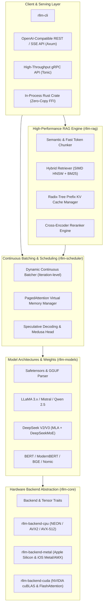

# `rllm`: Enterprise-Grade LLM Inference & High-Performance RAG Engine

A modular, zero-cost-abstraction, multi-backend LLM inference engine and high-throughput RAG platform written in Rust from the ground up.

---

## 1. High-Level System Architecture



---

## 2. Design Principles & Spectrum Scaling

`rllm` is designed to scale across three radically different tiers of hardware without compromising code cleanliness or throughput:

| Tier | Target Platforms | Key Architectural Constraints & Techniques |
| :--- | :--- | :--- |
| **Edge / Smartphone** | iOS (A-series/M-series), Android (ARM64) | Memory footprint < 2-4 GB; thermal throttling limits; Q4_K_M / Q2_K / BitNet 1.58b quantization; zero-copy mmap; SIMD NEON / Metal compute shaders. |
| **Workstation / Unified Memory** | Apple Silicon (M1–M4 Pro/Max/Ultra) | High memory bandwidth (up to 800+ GB/s); unified CPU/GPU address space; native Metal Shading Language (MSL) GEMM/GEMV; SIMDgroup matrix instructions. |
| **GPU Cluster** | NVIDIA H100 / A100 / L40S, multi-node | Massive parallel compute; continuous batching; PagedAttention block pooling; Tensor Parallelism (TP) over NCCL/NVLink; FlashAttention-2/3. |

---

## 3. Workspace Crates Hierarchy

```text
rllm/
├── Cargo.toml                  # Workspace definition with optimization profiles
├── crates/
│   ├── rllm-core/              # Tensor traits, DType, Shape, Memory Allocators, Error types
│   ├── rllm-backend-cpu/       # SIMD CPU engine (NEON, AVX2, multi-threaded Rayon)
│   ├── rllm-backend-metal/     # Apple Silicon Metal compute pipeline & shaders
│   ├── rllm-backend-cuda/      # CUDA / cuBLAS / FlashAttention runtime (feature-gated)
│   ├── rllm-models/            # Safetensors/GGUF loaders, LLaMA, Qwen, DeepSeek, BERT
│   ├── rllm-scheduler/         # PagedAttention, Continuous Batching, Radix KV cache
│   ├── rllm-rag/               # SIMD HNSW vector store, chunking, hybrid BM25, Reranker
│   ├── rllm-server/            # Axum HTTP + SSE + gRPC OpenAI-compatible server
│   └── rllm-cli/               # CLI benchmarker, interactive chat, and runners
```

---

## 4. Key Subsystem Details

### 4.1. Tensor & Backend Abstraction (`rllm-core`)
- Zero-overhead trait dispatch:
  ```rust
  pub trait Backend: 'static + Send + Sync + Clone {
      type Device: Device;
      type Storage: Storage;
      fn matmul(a: &Tensor<Self>, b: &Tensor<Self>) -> Result<Tensor<Self>>;
      fn rms_norm(x: &Tensor<Self>, weight: &Tensor<Self>, eps: f32) -> Result<Tensor<Self>>;
      fn rope(x: &mut Tensor<Self>, freqs: &Tensor<Self>, offset: usize) -> Result<()>;
      fn paged_attention(
          q: &Tensor<Self>,
          k_cache: &Tensor<Self>,
          v_cache: &Tensor<Self>,
          block_table: &BlockTable,
          scale: f32,
      ) -> Result<Tensor<Self>>;
  }
  ```
- Support for `F32`, `F16`, `BF16`, `I8`, `I4`, and block-quantized formats (`Q4_0`, `Q4_K_M`, `Q8_0`).

### 4.2. PagedAttention & Radix Prefix Caching (`rllm-scheduler`)
- Non-contiguous physical page tables (typically 16-token blocks).
- Virtual memory addressing for KV cache avoids 60-80% memory waste from over-allocation.
- **Radix Tree Prefix Cache**:
  - Automatically identifies common prefixes (e.g. system instructions, retrieved RAG context documents).
  - Skips prefill phase entirely for matching prefixes (0 ms TTFT for known chunks).

### 4.3. High-Performance RAG Subsystem (`rllm-rag`)
- **Direct Engine Integration**: Embedding generation (e.g., `bge-large-en`, `nomic-embed-text`) runs on the exact same tensor backend with zero serialization overhead.
- **Embedded SIMD HNSW Index**:
  - Vector similarity using ARM NEON / AVX-512 F16/F32 dot product.
  - Scalar Quantization (SQ8) for low memory usage.
- **Hybrid Fusion**:
  - Dense HNSW retrieval + BM25 inverted index fused via Reciprocal Rank Fusion (RRF).
- **In-Engine Cross-Encoder Reranker**:
  - Fast reranking pass directly in the GPU/Metal pipeline.
- **Prefix-Aware KV Assembly**:
  - Assembles retrieved context chunks sorted by access frequency to maximize Radix Tree KV-cache hits.
